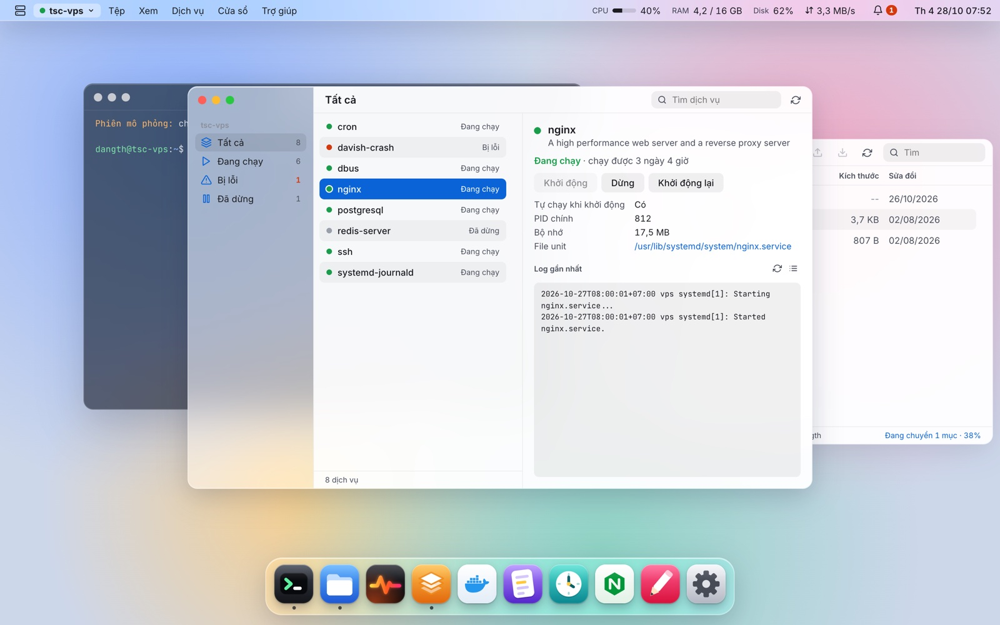

Dịch vụ systemd theo trạng thái, chi tiết và journal; khởi động, dừng, khởi động lại. Xóa dịch vụ không còn dùng: unit do admin tạo thì xóa file, unit của gói (như `certbot` cũ) thì chặn hẳn cùng timer chạy nó. Đăng nhập bằng user thường, Davish chạy qua `sudo` những gì systemd từ chối: hỏi mật khẩu sudo một lần mỗi phiên, chỉ giữ trong bộ nhớ (không lưu ổ đĩa, keychain hay nhật ký, mất sau 15 phút không dùng, khi ngắt kết nối hoặc khóa app), đưa cho sudo qua stdin, không bao giờ nằm trên dòng lệnh.

