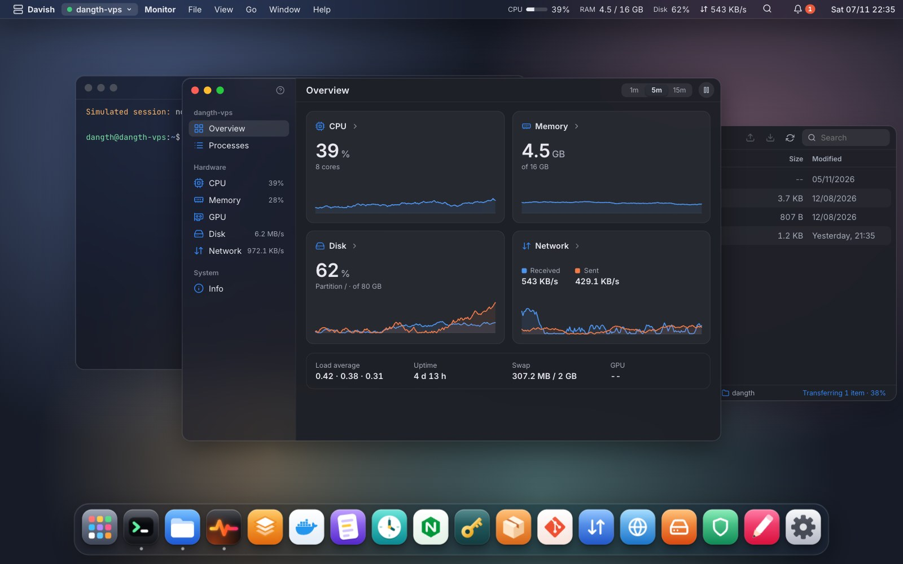
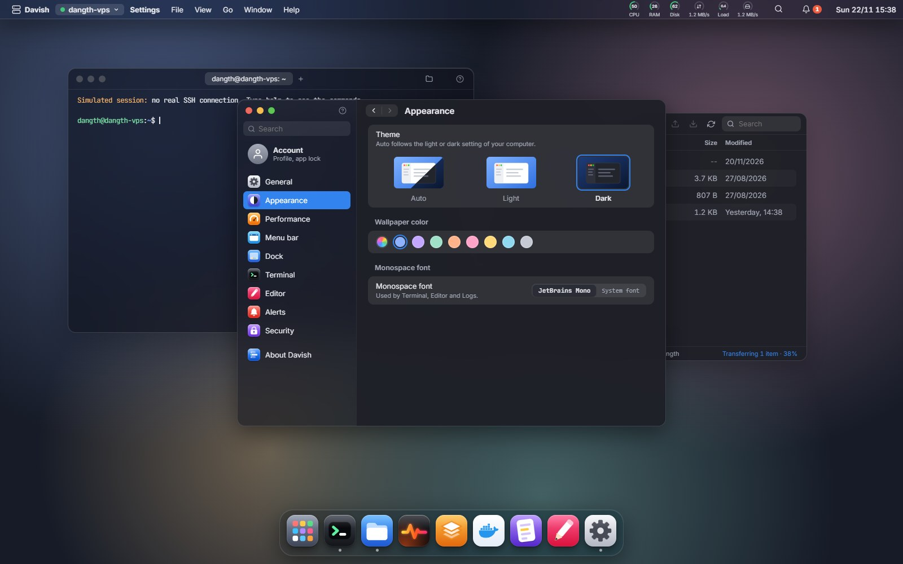
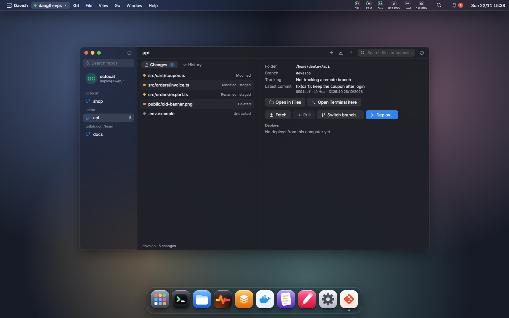
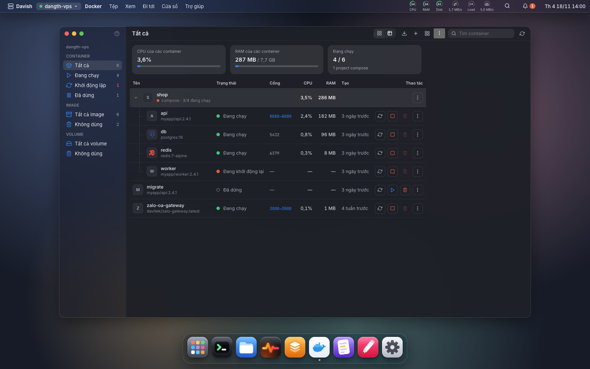
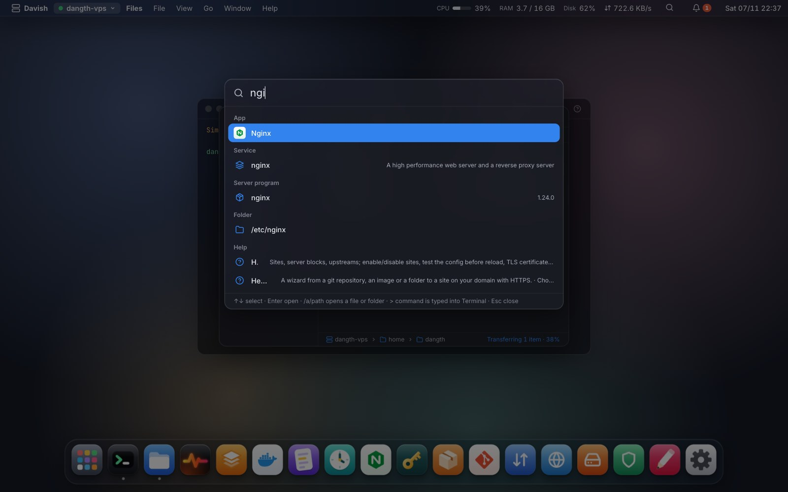

Davish có giao diện sáng và tối. Mặc định theo máy và tự đổi khi hệ điều hành đổi; muốn giữ một kiểu thì chọn Sáng hoặc Tối trong Cài đặt → Giao diện → Chế độ. Terminal và Logs vẫn tối như cũ, màu hình nền đã chọn được giữ và dịu đi cho nền tối.

Cài đặt → Hiệu năng chọn mức Davish dành cho hiệu ứng của chính nó: **Đẹp** (kính mờ), **Cân bằng** (bỏ độ mờ), **Nhẹ** (nền đặc, bóng ngắn, hình nền phẳng, không chuyển động), hoặc **Tự động**: giữ giao diện đầy đủ và gợi ý Nhẹ khi máy vẽ chậm. **Nâng cao** chỉnh từng hiệu ứng riêng. Đóng góp bởi @tian2992. **Kéo cửa sổ** chọn cách cửa sổ đi theo chuột: **Trực tiếp** (cả cửa sổ), **Đơn giản** (cũng vậy, nhưng tắt kính cho tới khi thả) hoặc **Viền** (chỉ một đường viền di chuyển, thả ra thì cửa sổ mới nhảy tới đó), cho máy kéo thấy chậm.

Dock mặc định nằm dưới; Cài đặt → Dock cho chuyển sang cạnh trái, phải hoặc trên (cửa sổ chừa chỗ cho Dock, thu nhỏ cửa sổ thì nó co vào icon của mình) và bỏ lớp kính để chỉ còn các icon trên hình nền.

  

  

  

  

