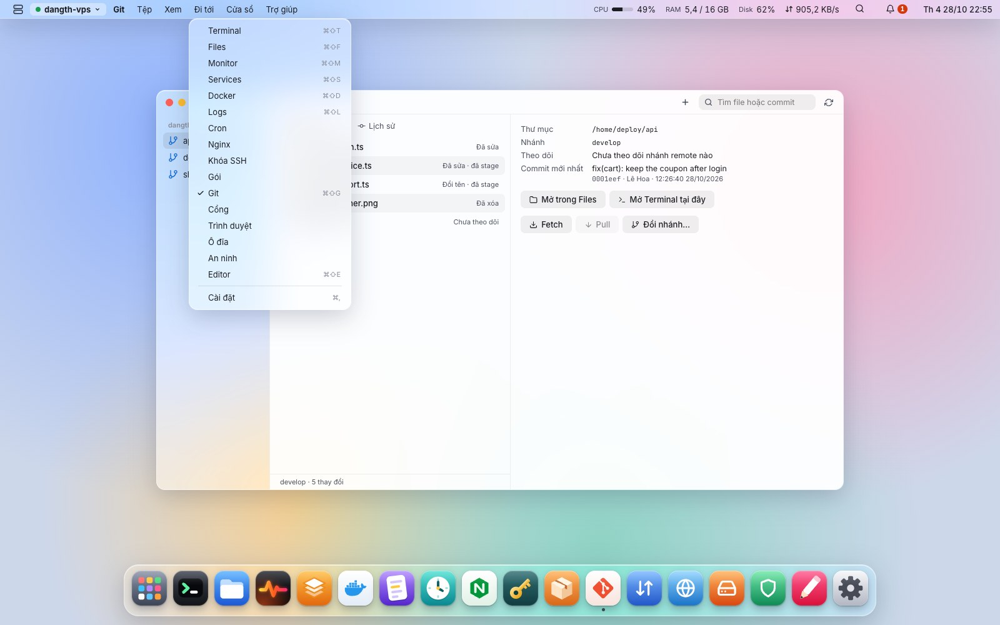
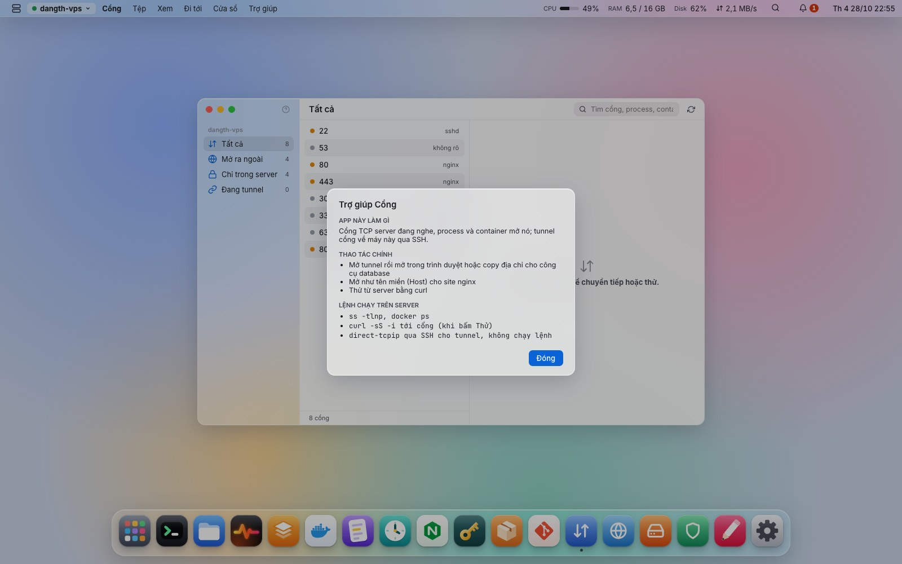

Menu bar thật (Tệp, Xem, Đi tới, Cửa sổ, Trợ giúp và lệnh của app đang mở), mọi phím tắt trong `⌘/`, nút `?` trên mỗi app giải thích app làm gì và chạy lệnh nào trên server, hướng dẫn nhanh lần đầu và chế độ xem thử với dữ liệu mẫu.

  

  

