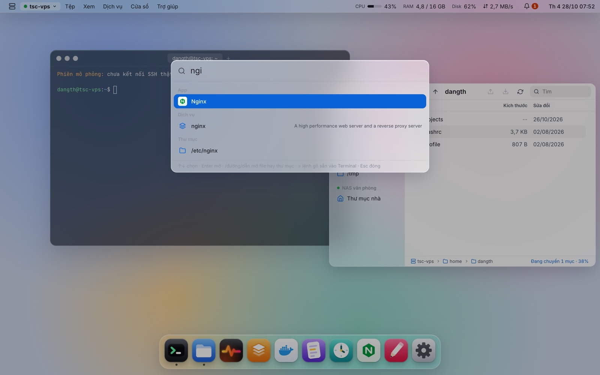
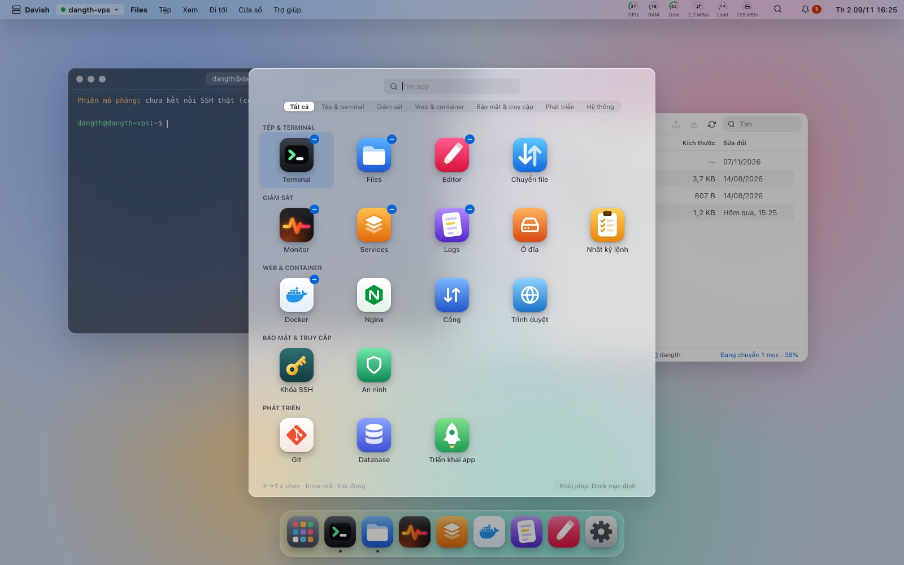

`⌘K` (hoặc kính lúp trên menu bar) để mở app, dịch vụ, container, thư mục, một `/đường/dẫn`, hoặc `> một lệnh` gõ sẵn vào Terminal. Launchpad (`⌘⇧A`) mở đầu bằng 5 app bạn mở gần nhất, rồi tới mọi app chia theo nhóm (tệp & terminal, giám sát, web & container, bảo mật & truy cập, phát triển, hệ thống), mỗi nhóm một tab, ô tìm kiếm tìm trên mọi nhóm; `+` ghim app vào Dock, `−` bỏ ra, và một nút đưa Dock về như lúc mới cài. Kéo một icon đã ghim dọc theo Dock để đổi chỗ; nhấn Esc khi đang kéo để trả nó về chỗ cũ.

  

  

